# MESHBERRY! (BETA...)

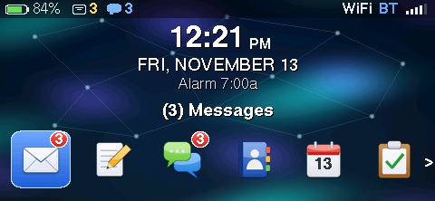 

## Documentation

- [Install guide](docs/INSTALL.md)
- [Meshberry and Mesherola](docs/MESHBERRY-MESHEROLA.md) – the OG firmware, in depth - (soon. ref Bold Docs for now)
- [MeshBerry Bold 9000](docs/BOLD-9000.md) – colour firmware, in depth
- [Web interface](docs/WEB.md) – web control panel
- [Feature comparison](docs/FEATURES.md) – side by side comparison
- [Maps](docs/MAPS.md) - maps setup info - (soon)
- [FAQ and basic troubleshooting](docs/FAQ.md)
- [Third-party notices](THIRD-PARTY-NOTICES.md) - (soon)

**THREE FLAVOURS OF FUTURE-PAST TECHNOLOGY**
<i>The future is 1999</i>

| | **Meshberry** | **Mesherola** | **MeshBerry Bold 9000** |
|---|---|---|---|
| **Start-up** | 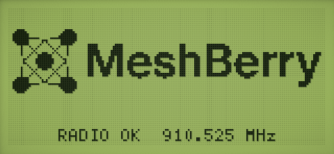 | 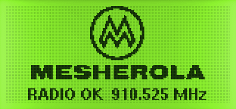 | 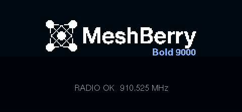 |
| **Main menu** | 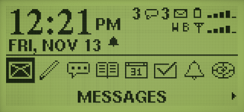 | 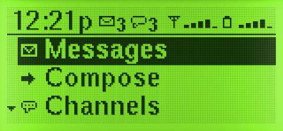 |  |
| **Chat** | 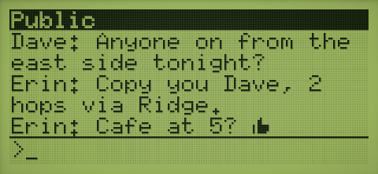 | 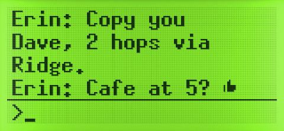 | 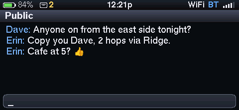 |
| **Radar / map** | 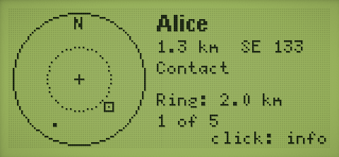 | 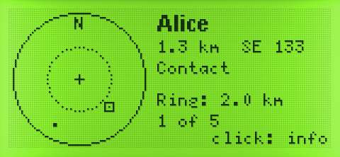 | 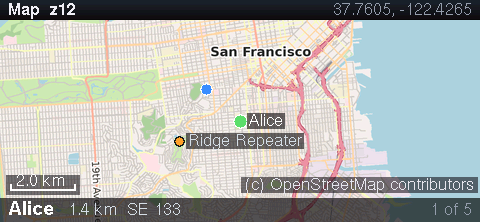 |

## PAGES OF PAGING!

**IT WORKS ALL BY ITSELF!**

Leave the phone in your pocket! Or at home! Or in a drawer! And if you DO own one of those fancy modern phones, MeshBerry will happily play companion radio to the MeshCore app over Bluetooth!

**MESSAGES! MESSAGES! MESSAGES!**

Private messages! Public channels! Private channels! Room servers! Delivery status! @mentions! EMOJI! Talk to your friends, random neighbours, that cute barista at the cafe you can't get the courage to talk to, and a mysterious node three hills away!

**PEOPLE!**

Address book! Discovered nodes! QR codes! NFC tags! Custom ring tones for your contacts and channels, because why should your favourite person sound like everybody else?!

**MESHNESS!**

Trace your paths! Inspect message routes! Check your signal! Find nodes on a radar or a map! Manage repeaters, rooms and sensors from your couch!

**AND THAT'S NOT ALL!**

Calendar! Tasks! Alarm! GPS! WiFi! A web page on your own network for messages, maps, files and settings! Flip it face-down to mute!

**YOUR OWN DATA??!**

Contacts! Messages! Settings! All living on the SD card! Move the card to another pager and take your world with you!

**PRIVACY? WE'VE GOT THAT TOO!**

MeshBerry doesn't advertise itself or share its position unless you tell it to. You're in control!

---

## KNOWN LIMITS

It works day to day, but expect rough edges; see [Known limits](docs/FAQ.md#known-limits).

## SOURCE

I have not published the source and pull requests are not accepted. I don't want spam pull requests in this repo, AI trolling the source or dropping random pulls, people selling variants of it, or this firmware to be sold preinstalled. However, if you would like to preinstall it, or you have legit reasons for wanting source or repo access, please contact me to see if we can work something out.

## BUG REPORTS / FEATURE REQUESTS

Bug reports and ideas are always welcome in [Issues](https://github.com/JettIsOnTheNet/MeshBerry-Firmware/issues).

## HARDWARE COMPATIBILITY

### Compatible hardware

| Device | Radio | Status |
|---|---|---|
| LilyGO T-LoRa Pager | SX1262 | Supported |
| LilyGO T-LoRa Pager - Meshtastic | SX1262?? | I assume it's the same unit with different firmware but... |
| LilyGO T-LoRa Pager | LR1121 | Not yet! Don't have one.. |

### Things I'd like to support
| Device | Radio | Status |
|---|---|---|
| LilyGO T-Deck Pro | SX1262 | Soon enough... |
| LilyGO T-Deck Pro - Meshtastic | SX1262? | Same question as Pager - Meshtastic?? |

A FAT32 microSD card (32 GB or smaller) is recommended!

## CREDITS AND DISCLAIMER

MeshBerry is built for [MeshCore](https://github.com/meshcore-dev/MeshCore) and LilyGO's board library, with thanks to both projects.

**<i>This is a parody project built for funzies. It is not created by or endorsed by LilyGo, MeshCore, RIM, BlackBerry Limited or Motorla in any way shape or form.<i>**

**Radio rules differ by country. Choose the region that matches where you are and keep to your local power and duty-cycle limits.**
