# MeshBerry Bold 9000

The colour firmware for the LilyGO T-LoRa Pager: MeshCore messaging with a late-2000s smartphone look, colour emoji, a map, and sounds from a small built-in synthesizer. It does everything the dot-matrix firmware does and has the same nine entries on its main screen; the two are separate downloads, and the dot-matrix one is described in [Meshberry and Mesherola](MESHBERRY-MESHEROLA.md).

Install it from the files whose names start with `MeshBerryBold-` ([install guide](INSTALL.md)). Screenshots are from the firmware's simulator; the names in them are sample data.

## Contents

- [First start](#first-start)
- [Controls](#controls)
- [The main screen](#the-main-screen)
- [Messages](#messages)
- [Channels](#channels)
- [Adding people](#adding-people)
- [Map](#map)
- [Message Info, Node Info and Trace Path](#message-info-node-info-and-trace-path)
- [Alerts](#alerts)
- [Screen](#screen)
- [Calendar, tasks and alarm](#calendar-tasks-and-alarm)
- [Date and time](#date-and-time)
- [WiFi](#wifi)
- [Web interface](#web-interface)
- [GPS](#gps)
- [Radio](#radio)
- [Remote admin](#remote-admin)
- [SD card](#sd-card)
- [Phone app](#phone-app)
- [Battery life](#battery-life)

What each of the three looks has, side by side, is in the [feature comparison](FEATURES.md).

## First start

| | |
|---|---|
|  *Start-up: the logo, then how the radio came up* |  |

1. The pager asks for your **region**. Pick the one that matches your local mesh; frequency, bandwidth and spreading factor are set for you.
2. It asks for a **name**, whether to **advertise** yourself to the mesh, and whether to **share your GPS position**.

Advertising and position sharing are both off unless you answer *On*. If you skip the questions the pager does not advertise, and nobody can add you or message you privately until you turn *Advertise* on under *Options → LoRa Radio*.

If no SD card is in, you will see *NO SD CARD: USING FLASH*. Everything works; your data is kept inside the pager instead.

## Controls

| Control | What it does |
|---|---|
| Wheel, turn | Move through lists and menus |
| Wheel, press | Select, or open the menu for the current screen |
| Wheel, hold | In settings: a tip for the setting. In the emoji picker: keep as a favourite |
| Shift + wheel | A screenful at a time. On the main screen: brightness |
| Space + wheel | On the main screen: volume |
| Enter | Same as pressing the wheel; sends a message while typing |
| Shift + Space | The emoji picker, while writing a message |
| BOOT button, short press | Screen off (and, with *Key Lock* on, keys locked) |
| BOOT button, hold 1.5 s | Power off |
| Backspace | Delete; on an empty line and in lists, back |
| Backspace, hold 1.5 s on the main screen | Keyboard light on / off |

### Typing

- Hold either shift key (beside Z or beside M), or hold SPACE, and press a key to type the symbol printed on it.
- Tap shift once for one capital letter. Tap it twice for caps lock; tap again to release.

### Quick brightness and volume

On the main screen, hold **Shift** and turn the wheel for a brightness slider, or hold **Space** and turn it for volume. Turning up gives more. Volume plays a short tick at the new level when you stop turning. The slider goes away by itself a few seconds after the last turn, or at once with any key.

| | |
|---|---|
| 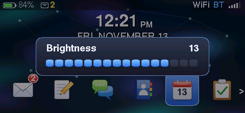 *Shift + wheel: brightness* | 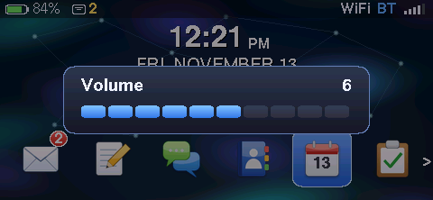 *Space + wheel: volume* |

### Tips

Not sure what a setting does? In any settings list, **hold the wheel** on it (or press **?**) for a short explanation. On the less obvious settings the tip also comes up by itself if you rest on one for a few seconds; turning the wheel carries on to the next setting.

| | |
|---|---|
| 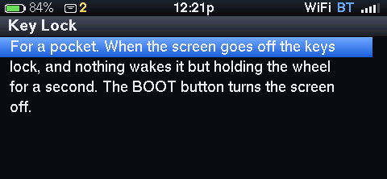 *A tip* |  |

### Emoji

While writing a message, press **Shift + Space** for the emoji picker. It takes the whole screen.

| Control | What it does |
|---|---|
| Wheel | One emoji at a time: through the favourites row at the top, then on down the list |
| Shift + wheel | A screenful at a time |
| Space | Jump to the next group (faces, people, animals, food, travel...) |
| Wheel click or Enter | Put the emoji in your message |
| Hold the wheel | Keep the emoji in the favourites row. Held on a favourite: take it out |
| Backspace | Leave without picking |

The favourites row holds as many as fit across the screen. A new favourite goes on the right and the others move left; when the row is full, the oldest one on the left drops off.

Bold 9000 has the full set in colour, about 1,700, in the plain yellow form. Skin-tone and gendered variants that other people send are shown as their plain version.

| | |
|---|---|
| 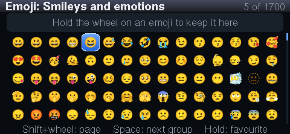 *The emoji picker* | 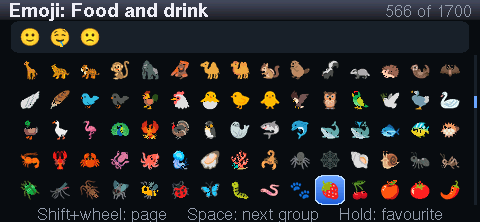 *Space jumps a group at a time* |
| 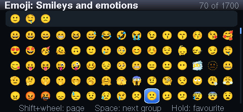 *Favourites along the top* |  |

### Questions and notices

Anything that asks first (*leave this channel?*) or reports back (*SAVED*) comes up as a box in the middle of the screen. Turn the wheel to pick a button and click; **Y** and **N** answer too, and Back is always *no*.

| | |
|---|---|
| 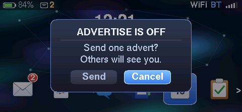 *A question: Y, N, or the wheel* | 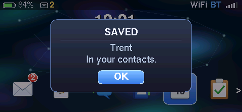 *A notice: any key puts it away* |

### Key Lock, for a pocket

Keys get pressed in a pocket. Turn on *Options → Device → Key Lock* and, once the screen has gone off, the keyboard and the wheel do nothing at all: they do not even light the screen. To get back in, **hold the wheel down for a second**; the screen shows *KEYS LOCKED* and a bar that fills while you do.

| | |
|---|---|
| 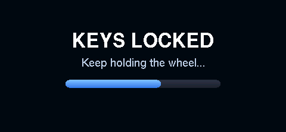 *Unlocking: the bar fills while the wheel is held* |  |

- A short press of the **BOOT** button turns the screen off straight away, which locks it.
- A message can still light the screen (if *Wake Screen* is on) and an alarm still rings; any key silences the alarm. The screen shows *KEYS LOCKED*, not what is underneath, until you unlock it.
- On USB power the web sign-in number and the *Web Interface* screen show through the lock, so you can sign in from the desk. On the battery they wait for the unlock too.
- Turned face down (*Flip to Mute*), the screen goes dark and quiet at once, but the keys lock only after the usual screen time-out.
- While it is locked the BOOT button does nothing, so a pocket cannot switch the pager off.
- With Key Lock off, nothing changes except that BOOT turns the screen off and any key wakes it.

### Power

- **Off:** hold BOOT, or choose *Power Off* at the bottom of Options. The pager says *HOLD WHEEL TO POWER ON* and switches everything off.
- **On:** hold the wheel or BOOT for about a second. A short bump does nothing, on purpose.
- At 10% it warns once. When the battery is empty it says so and switches itself off cleanly; charge it over USB to bring it back.

## The main screen

| | |
|---|---|
| 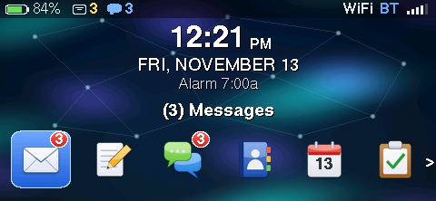 *The main screen* |  |

Nine entries, the same in every style:

Messages · Compose · Channels · Address Book · Calendar · Tasks · Alarm · Map · Options

Along the top: battery, unread private messages, unread channel messages, the clock, **WiFi** and **BT** when they are connected, and signal bars. The main screen also shows the date and the alarm time when one is set. Turn the wheel to move along the icons; there are more to the right.

| | |
|---|---|
| 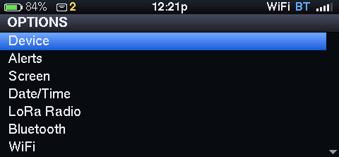 *Options: every group of settings* | 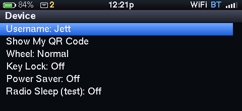 *Inside one group* |

## Messages

**Messages** holds private conversations, one row for each person, newest first. Open a row to see the whole conversation, oldest at the top. Type and press Enter to answer; the wheel scrolls back.

| | |
|---|---|
| 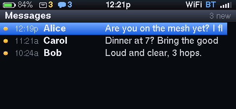 *Messages: one row per person* | 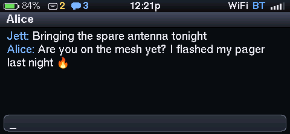 *A conversation* |
| 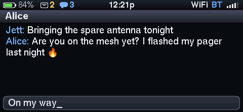 *Writing a reply* | 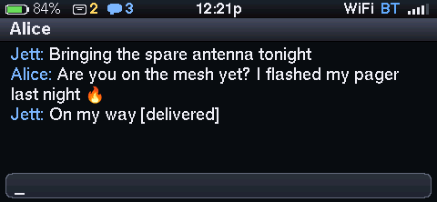 *Sent, then delivered* |

Your latest message shows *[sent]* and then *[delivered]* once the other pager confirms it; one that never got through stays marked *[not delivered]*. With nothing typed, press the wheel for Message Info, Trace Path, Node Info and Delete Conversation.

| | |
|---|---|
| 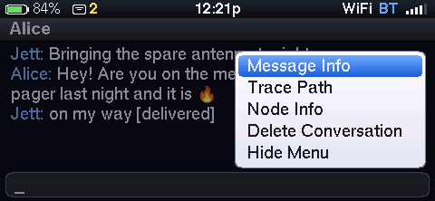 *The conversation menu* |  |

**Compose** starts a conversation. Pick a person, type, press Enter.

| | |
|---|---|
| 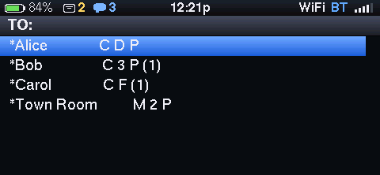 *Compose: pick who to write to* | 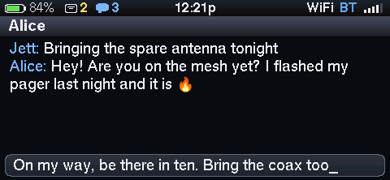 *Writing a new message* |

A message can be 160 bytes: plain letters are one each, emoji and accented letters more. On a channel your name travels with the text, so the room is 160 less your name and two.

A private message needs the other person in your address book and you in theirs. See [Adding people](#adding-people).

## Channels

**Channels** lists the Public channel and any you have joined. Inside a channel, type and press Enter to post.

| | |
|---|---|
| 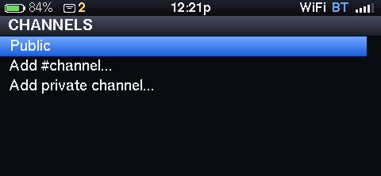 *Channels* | 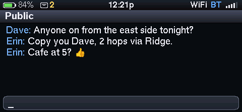 *The Public channel* |
| 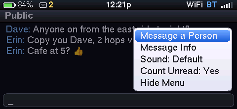 *The channel menu* |  |

- Type `@` to pick a name to mention.
- Press the wheel with nothing typed for the channel menu:
  - **Message a Person** – pick someone who has posted, add them and write to them privately
  - **Message Info** – pick a message and see how it reached you
  - **Sound** – step through ring tones for this channel
  - **Count Unread** – *Yes* or *No*. Set to *No*, this channel's unread messages are left out of the channel count on the main screen (handy for Public or a busy test channel). They still show beside the channel's name in the Channels list
  - **Leave Channel** – on channels you added
- *Add #channel…* joins an open channel by name. The box starts with the `#` already in it, and the name is made lower case: an open channel's key comes from its name, so `#Test` and `#test` would be different channels, and lower case is what the rest of the mesh uses. *Add private channel…* joins one by name and key, or makes a new key if you leave it blank.
- **To leave a channel:** in the Channels list, hold the wheel on it or press **D**, then choose *Leave* in the box that comes up (or press **Y**). Its messages are deleted with it. Public cannot be left.
- In a channel, typing `/key` shows its key; `/leave` leaves it without asking.

## Adding people

| | |
|---|---|
| 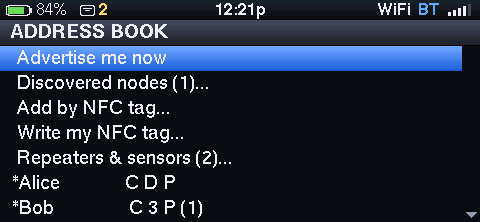 *Address Book* |  |

Someone can be added once the pager knows their public key. Four ways:

1. **Advert.** When they advertise, they appear under *Address Book → Discovered*. Nobody is added by themselves: the list holds the last 50 nodes heard, people first, then repeaters, rooms and sensors, and with an SD card it is kept for 30 days. Click to add; the pager says *Added*. If the address book is full (it holds 64) it offers to replace the contact heard longest ago that is not starred. *Advertise me now* sends yours. With *Advertise* switched off it is *Advertise me once*: it asks first, then sends a single advert and leaves the setting off.
2. **From a channel.** Channel menu → *Message a Person*. If their advert has not been heard yet, the pager offers to ask them for one.
3. **QR code.** *Options → Device → Show My QR Code* shows your contact code for the MeshCore phone app to scan.
4. **NFC tag.** *Address Book → Add by NFC tag*. The pager shows *TOUCH NFC TAG TO MESHBERRY*; hold the tag against its back. It tells you what the tag holds - a person, a repeater, a channel - and asks before saving anything (Y and N answer it). *Address Book → Write my NFC tag* puts your own contact on a blank or rewritable tag, for others to scan. The NFC reader is powered only while that screen is up, and gives up by itself after half a minute.

| | |
|---|---|
| 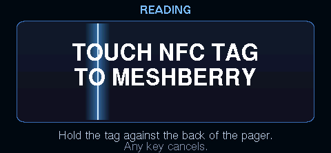 *Add by NFC tag: waiting for a tag* | 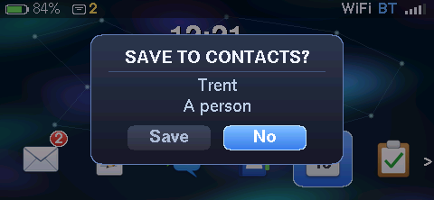 *What the tag held, and the question* |
| 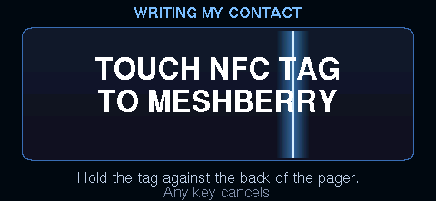 *Write my NFC tag* | 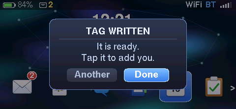 *Written* |

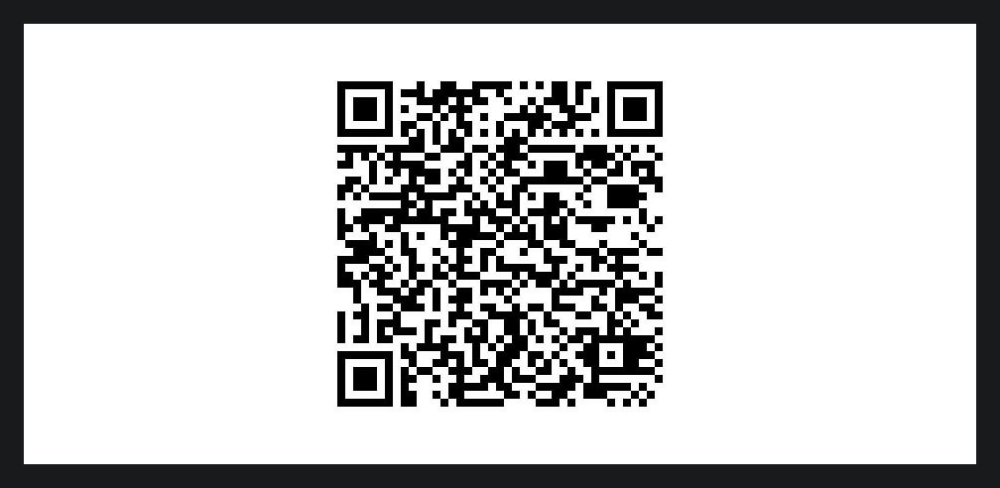

Repeaters, room servers and sensors you have added are kept in their own list inside the Address Book. Star the contacts you want to keep for good (*Node Info* menu): a starred contact is never the one replaced when the address book is full.

## Map

**Map** shows your position and every saved or discovered node that shares one, over map tiles you put on the SD card. Getting tiles onto the card is covered in [Maps](MAPS.md); cards made with Meshtastic's map tile tools work as they are.

| | |
|---|---|
| 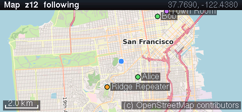 *The map, following your position* | 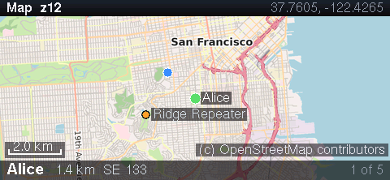 *A node selected: name, distance, bearing* |
| 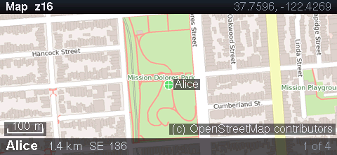 *Street level* | 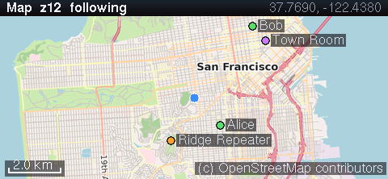 *Zoomed out* |
| 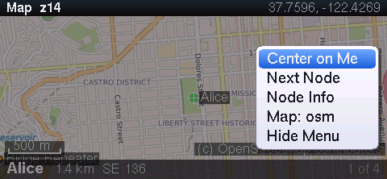 *The map menu* | 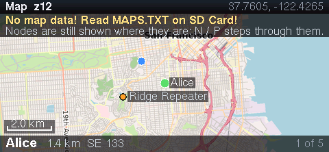 *No tiles on the card: still a radar* |

| Control | What it does |
|---|---|
| Wheel | Zoom in and out |
| W A S D | Move the map |
| N / P | Next / previous node |
| Space or M | Back to your own position, and follow it |
| Enter or wheel press | Menu: Center on Me, Next Node, Node Info, switch tile set |
| Backspace | Leave |

Your position is the blue dot. People are green, repeaters orange, room servers purple, sensors grey. The selected node shows its name, distance and bearing along the bottom.

**Without map tiles** the screen still works as a radar: nodes are drawn where they are, N and P step through them, and the bottom line gives distance and bearing. A strip along the top says *No map data! Read MAPS.TXT on SD Card!*, and the pager writes that file onto the card with instructions. Tiles copied to the card afterwards (the web interface can do it) show up without a restart.

Map data in these pictures © [OpenStreetMap](https://www.openstreetmap.org/copyright) contributors, © [OpenMapTiles](https://openmaptiles.org/).

## Message Info, Node Info and Trace Path

| | |
|---|---|
| 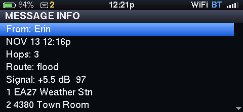 *Message Info: how a message reached you* | 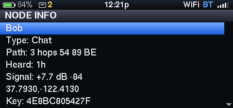 *Node Info* |
| 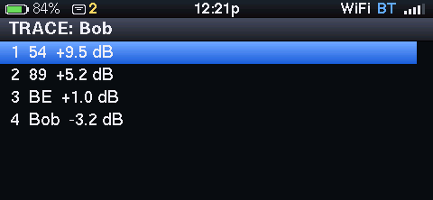 *Trace Path: signal at every hop* |  |

**Message Info** (from a conversation or channel menu) shows when a message arrived, how many repeaters it passed, whether it was flooded or sent along a known path, the signal it was heard at, and the repeaters on the way.

**Node Info** shows a contact's type, the path to it, when it was last heard, its signal, its position if it shares one, and its key. From there you can reset the path, give the person their own ring tone, or remove them.

**Trace Path** sends a packet out along the known path and back, and lists the signal at each repeater.

## Alerts

| | |
|---|---|
| 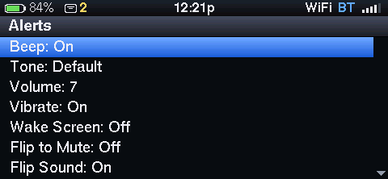 *Alerts* |  |

*Options → Alerts*

| Setting | Meaning |
|---|---|
| Sound, Tone, Volume | The default ring |
| Vibrate | Buzz on a message |
| Wake Screen | Turn the screen on for a message (off by default, to save battery) |
| Flip to Mute | Lay the pager face down: two quick blips stepping down, then it is silent with the screen off. Pick it up: two stepping up and it is awake. With *Key Lock* on, the keys lock only after the usual screen time-out, not the moment it is turned over |
| Flip Sound | Those blips, on or off |
| Mute Public | No alert for the Public channel |

A person can have their own tone (*Node Info → Sound*), and so can a channel (channel menu → *Sound*). *Silent* is one of the choices.

Bold 9000's tones (Bold, Kalimba, Lantern, Harp, Droplet, Signal, Knock, Evening, Classic Beep, Double Beep) are made by a small built-in synthesizer: struck and plucked instruments whose notes ring over each other. Its start-up, power-off and other interface sounds use the same voices.

## Screen

| | |
|---|---|
| 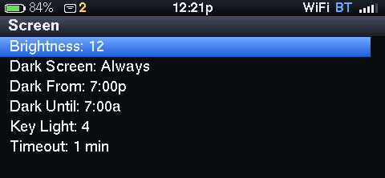 *Screen settings* |  |

*Options → Screen*: brightness, **Dark Screen**, keyboard light level and screen timeout.

**Dark Screen** chooses between the dark look and the light one: *Always* (dark, the default), *Off* (light), or *At night* (dark between *Dark From* and *Dark Until*, light by day). In *At night* the keyboard light follows it: on in the dark, off by day.

| | |
|---|---|
| 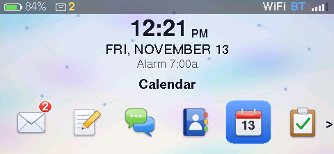 *The light look: the main screen* | 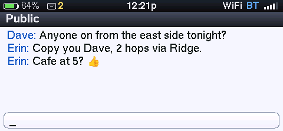 *The light look: a channel* |

### Wallpaper

The main screen has one background for the dark look and another for the light one. To use your own picture, put a PNG on the SD card, 480 × 222 pixels:

| File | Used for |
|---|---|
| `/wallpaper.png` | Both looks |
| `/wallpaper-dark.png` | The dark look only |
| `/wallpaper-light.png` | The light look only |

The clock and labels turn dark on a bright picture and white on a dark one. A new picture is picked up at start-up, or when the look changes. The web interface's file page is an easy way to copy one over.

## Calendar, tasks and alarm

| | |
|---|---|
| 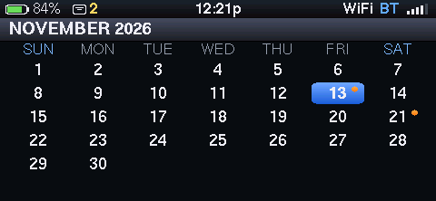 *Calendar* | 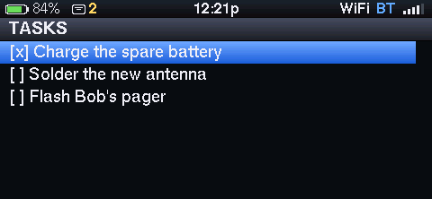 *Tasks* |
| 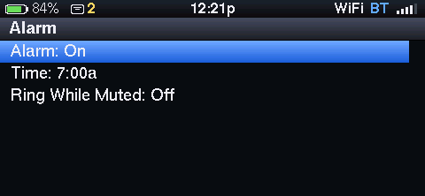 *Alarm* |  |

**Calendar** shows the month, with a dot on days that have something; open a day to add or read its entries. **Tasks** is a checklist: click to tick one off.

**Alarm** rings once a day at the time you set. *Ring While Muted* lets it ring even when Sound is off or the pager is flipped face down. Any key silences it.

## Date and time

*Options → Date/Time*: set the time and date by hand, choose a **Clock** of 12 or 24 hours (every time on the pager follows it, and you can type times either way: `19:05` or `7:05p`), and your zone.

**Time from GPS** sets the clock from the satellites. It only does anything while GPS is switched on (*Options → GPS*) and has a fix; the row says *GPS off* when it is waiting for that. Indoors, with no fix, the clock is left alone. The clock keeps running from the pager's own clock chip in between.

## WiFi

| | |
|---|---|
| 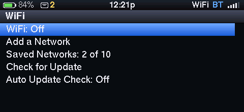 *WiFi* | 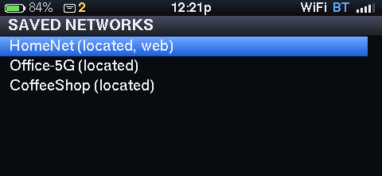 *Saved networks* |
| 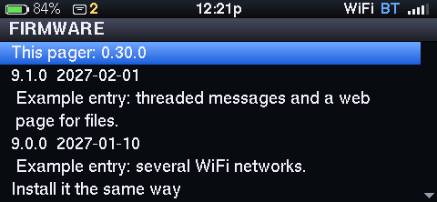 *Check for Update* |  |

*Options → WiFi*. The pager remembers up to ten networks: **Add a Network** scans, you pick one and type its password. **Saved Networks** lists them; click one to forget it or to change whether the web interface starts by itself there.

| WiFi | What it does |
|---|---|
| Off | Radio off |
| Charging | On while the pager is on USB power, off the moment it is unplugged |
| Auto | The WiFi radio stays powered down until there is a reason to look: at start-up, when you add a network, and - with GPS on - when you come within about 50 m of the place where a saved network was added. When the network goes out of range the radio powers down again |
| On | Radio stays on and keeps looking |

*Auto* is the one to use on a pager you carry. A network remembers where it was added if the GPS had a position then, or picks one up the next time you are connected with a position; **Saved Networks** marks those *(located)*. Without GPS, Auto only looks at start-up, so switch to *On* when you want it. WiFi being up stops Radio Sleep, and costs battery.

**Check for Update** fetches the release list and shows anything newer than what the pager is running. Turn on **Auto Update Check** and it looks by itself when WiFi connects (once a day at most) and tells you when there is something new. It only tells you; installing is still done the way you installed the first time.

## Web interface

| | |
|---|---|
| 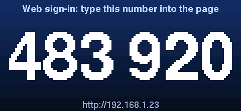 *The sign-in number, shown when a browser connects* |  |

With WiFi connected, the pager serves a page on your local network for messages, contacts, a live map, settings and the SD card's files. Turn it on under *Options → Web Interface*, open the address it shows in a browser on the same network, and type in the six-digit number the pager puts on its screen.

It has a guide of its own, with pictures: **[Web interface](WEB.md)**.

## GPS

*Options → GPS*: **Off**, **On**, or **Power Saver**. Power Saver switches the receiver on just long enough to get a fix, then puts it into standby for ten minutes, so your position can be up to ten minutes old but the receiver uses a small fraction of the power. In standby it keeps what it knows about the satellites, so the next fix is quick. *Share Position* decides whether the mesh is told where you are; it is off unless you turn it on.

## Radio

*Options → LoRa Radio*: region preset, advertise on/off, frequency, bandwidth, spreading factor, coding rate, transmit power, and **Path IDs**. Everyone on a mesh must share frequency, bandwidth and spreading factor.

**Advertise** decides whether the pager announces itself to the mesh at all. **Auto Advert** repeats your advert every 12, 24 or 47 hours. It is off by default and only applies while *Advertise* is on.

Path IDs is 1-byte unless you change it, which every MeshCore node can read. 2-byte and 3-byte make routes more reliable on big meshes, but firmware older than MeshCore 1.14 and some other MeshCore clients cannot read those packets at all: they will not see your messages or your adverts. Only raise it if everything around you is on 1.14 or later.

## Remote admin

| | |
|---|---|
| 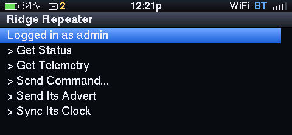 *Logged in to a repeater* |  |

*Options → Remote Admin* lists the repeaters, room servers and sensors in your contacts. Pick one and enter its password (leave it blank to log in as a guest). Once logged in:

- **Get Status** – battery, uptime, noise floor, last signal, packet counts, air time
- **Get Telemetry** – whatever sensors the node reports
- **Send Command…** – type a console command and read the answer
- **Send Its Advert**, **Sync Its Clock** – the two most common commands, one click each

What you may do depends on the password: guests can read, admins can change things.

## SD card

With a card in at start-up, settings, organizer, ring tones, contacts, channels and messages are kept in a `meshberry` folder on the card. Move the card to another pager running MeshBerry and it starts with all of them. Use a FAT32 card of 32 GB or less.

Your node's private key is **not** on the card. To become the same node on another pager, use *SD Card → Export Private Key…* on the old one and *Import Private Key…* on the new one. Anyone holding a card with an exported key can act as you, so delete `meshberry/private_key.txt` afterwards.

*SD Card* also has: a running **Message Log** (`meshberry/log.txt`, every message as plain text), *Export Messages*, *Eject Card* and *Format Card*.

The *Discovered* list is kept on the card too (`meshberry/heard.bin`), so it is still there after a restart; nodes not heard for 30 days are dropped from it. Without a card the list starts empty each time.

## Phone app

*Options → Bluetooth* turns the companion link on. Pair from the MeshCore app; the default PIN is **012345** and can be changed in the same menu (restart afterwards). Messages you send from the app also appear on the pager.

## Battery life

The biggest savers, in order: GPS off or on *Power Saver*, WiFi off or on *Auto*, a short screen timeout, *Wake Screen* off, Bluetooth off when not using the phone app, the web interface off when nobody is using it.

With the screen off the pager runs slower to save power - except on USB power, or while the web interface is running, where it stays at full speed so that a browser is not kept waiting.

*Options → Device → Power Saver* runs the processor slower. Screens draw a little slower; nothing else changes.

*Options → Device → Radio Sleep (test)* stops the processor while the screen is off and wakes it for incoming packets and key presses. It only takes effect with Bluetooth, GPS and WiFi off and the pager unplugged. It is still being tested and you may miss messages with it on, so the pager asks you to confirm when you switch it on.

---

See also: [Install guide](INSTALL.md) · [Maps](MAPS.md) · [FAQ and troubleshooting](FAQ.md) · [Meshberry and Mesherola](MESHBERRY-MESHEROLA.md)
