# Web interface

With WiFi connected, the pager serves a page on your local network. From any browser on that network you can read and write messages, manage contacts and channels, see everyone on a live map, change any setting, and manage the files on the SD card. It is the same in both firmwares.

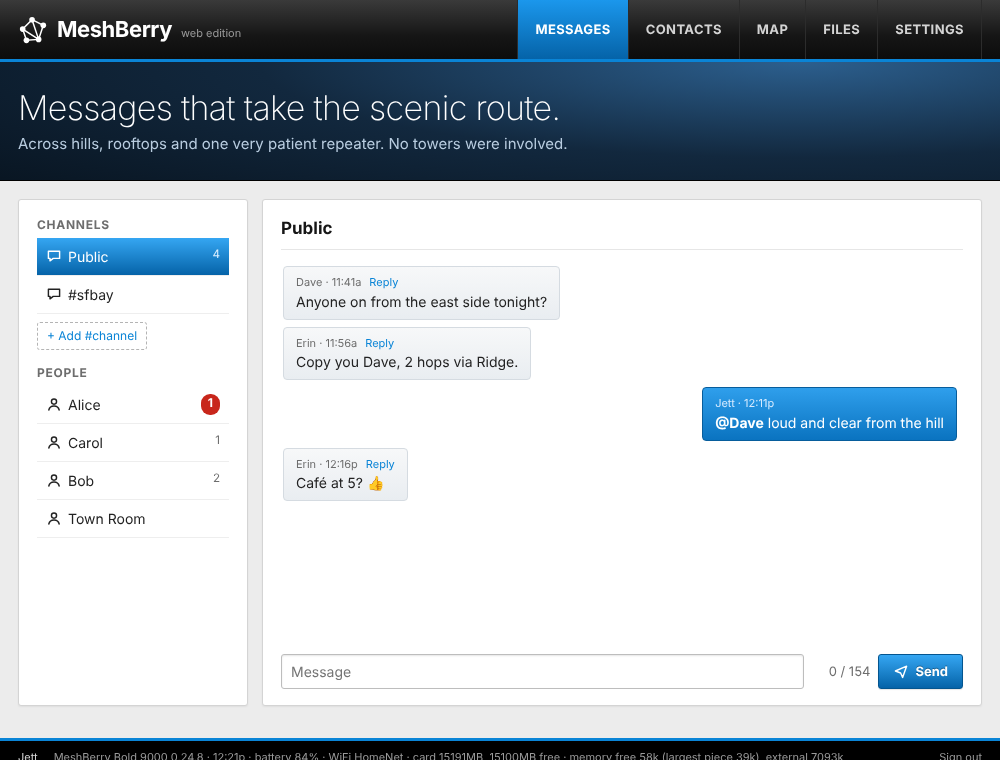

## Contents

- [Turning it on](#turning-it-on)
- [Signing in](#signing-in)
- [Messages](#messages)
- [Contacts](#contacts)
- [Map](#map)
- [Files](#files)
- [Settings](#settings)
- [On a phone](#on-a-phone)
- [Security: read this once](#security-read-this-once)
- [When it does not work](#when-it-does-not-work)

## Turning it on

*Options → Web Interface* on the pager.

| Setting | Meaning |
|---|---|
| Web Interface | On: runs on whatever network the pager is on. Off: runs only on networks you have marked for it |
| *(per network)* | **Auto web interface**: when you add a WiFi network you are asked whether the web interface should start by itself there. The answer is No unless you say Yes. Change it later in *WiFi → Saved Networks* (the ones set to Yes are marked *web*). So it can come up at home and stay off at work |
| Now | The address to type into a browser, such as `http://192.168.1.23`, while it is running |
| On When Charging | Plugging in USB power brings WiFi up by itself, whatever the WiFi setting; the web interface then starts if the network is one marked for it (or Web Interface is On). Unplugging puts things back |
| Mute In Use | No alert sounds while a browser is signed in |
| Screen Off In Use | The screen goes dark once a browser has signed in |

| Meshberry | Mesherola | MeshBerry Bold 9000 |
|---|---|---|
| 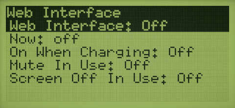 | 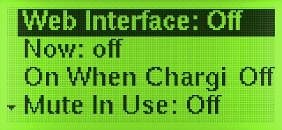 | 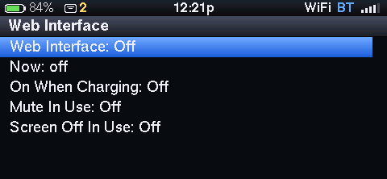 |

WiFi has to be connected first; see the WiFi section of your firmware's guide ([Meshberry and Mesherola](MESHBERRY-MESHEROLA.md#wifi), [MeshBerry Bold 9000](BOLD-9000.md#wifi)).

## Signing in

1. Open the pager's address in a browser on the same network. It starts with `http://`, not `https://`.
2. The pager beeps and shows a six-digit number, filling its screen so it can be read from where you are sitting.
3. Type it into the page. The sixth digit signs you in; a pasted number fills all six boxes.

| Meshberry | Mesherola | MeshBerry Bold 9000 |
|---|---|---|
| 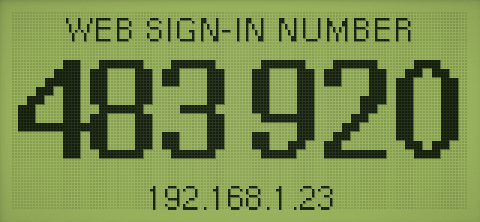 | 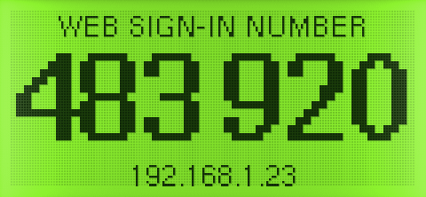 | 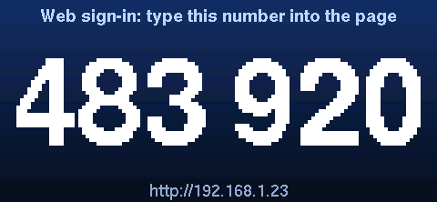 |

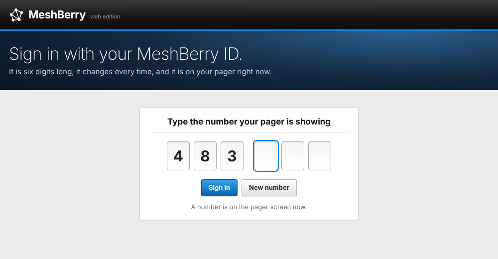

A new number is made every time someone signs in, it works once, it lasts two minutes, and it only ever appears on the pager's screen: getting in takes being able to see the pager. With *Key Lock* on, the number shows through the lock screen while the pager is on USB power; on the battery, unlock it first (hold the wheel for a second). Five wrong numbers lock sign-in for 30 seconds, and twice as long each time it happens again, up to 16 minutes. **Sign out** is at the right of the bar along the bottom, which also shows the pager's battery, WiFi, card and free memory.

## Messages

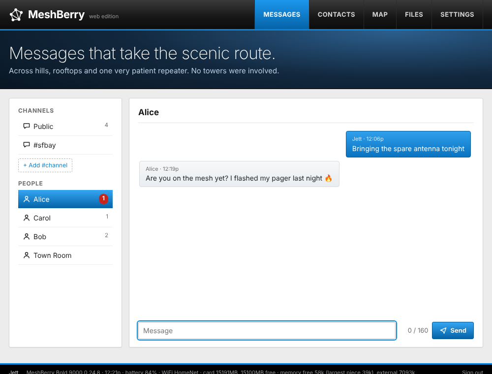

- Channels and people are listed on the left, with unread counts. Pick one, type, press Enter.
- Your newest message in a conversation says *sent*, then *delivered* once the other pager confirms it. A channel has no confirmations, so there *sent* means it went out on the radio. A message that could not go out is marked *not sent* or *not delivered*.
- The counter beside the box is the room left: 160 bytes for a private message, a little less on a channel because your name travels with the text. The box stops taking input at the limit.
- On a channel, *Reply* starts your answer with that person's name, and typing `@` offers names to pick from.
- **+ Add #channel** joins an open channel by name. **Leave channel**, beside a channel's name, leaves it and deletes its messages (it asks first; Public cannot be left).
- A conversation you open here is marked read on the pager too.
- Click a message for how it reached you: hops, route, signal and the repeaters on the way.

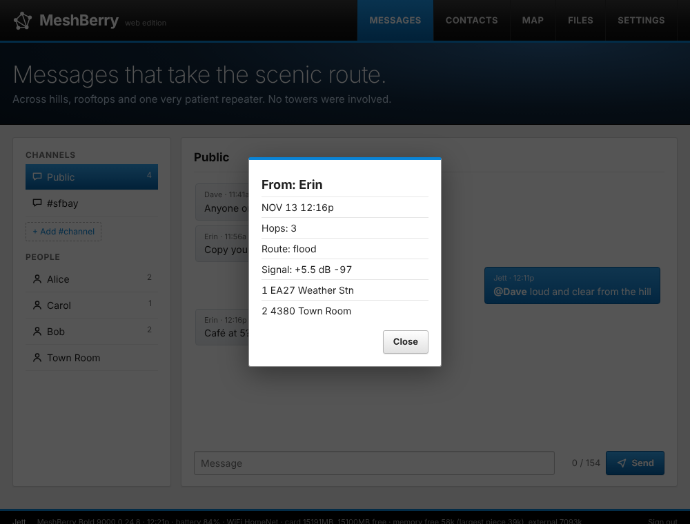

## Contacts

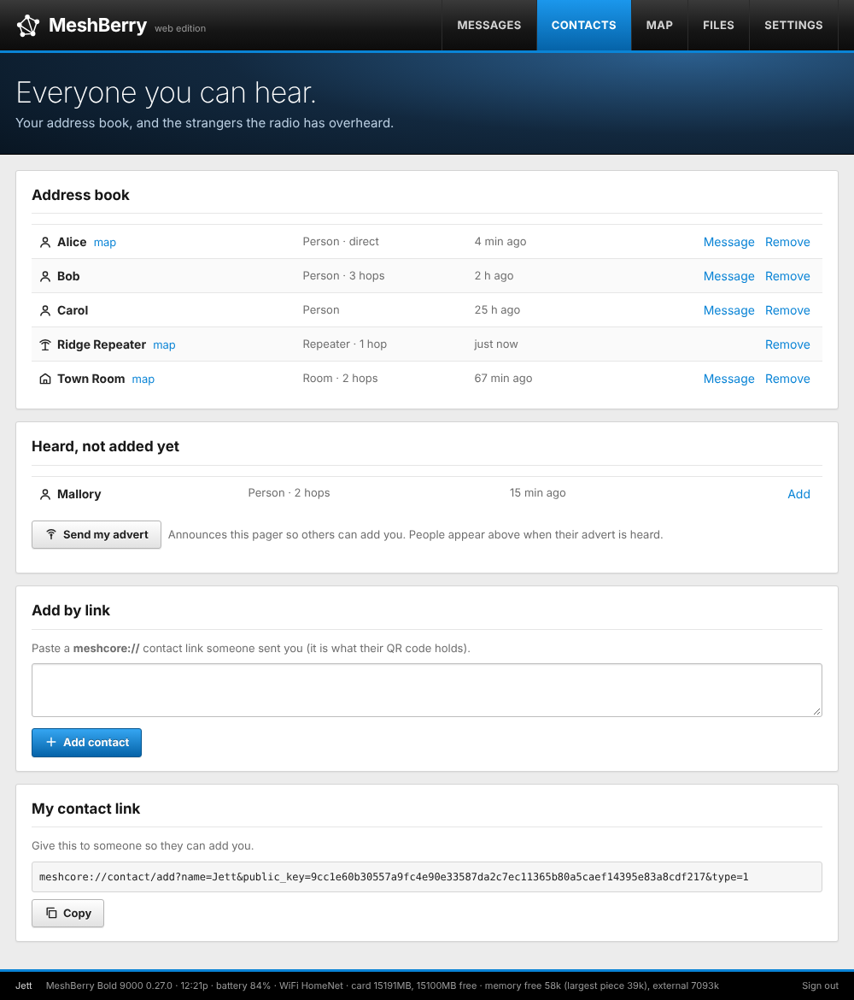

*Contacts*

- **Address book:** everyone you have added. *Message* opens a conversation, *Remove* takes them out, *map* opens their position on openstreetmap.org, and their name opens the same details as the pager's Node Info.
- **Heard, not added yet:** the last 50 nodes whose adverts the pager has heard. Nobody is added by themselves; *Add* puts one in the address book. If the address book is full (64), the contact heard longest ago that is not starred makes way - from the page this happens without a question.
- **Send my advert** announces your pager so that others can add you. With *Advertise* off in the pager's radio settings it asks first, then sends just the one.
- **Add by link:** paste a `meshcore://` contact link, which is what a contact's QR code holds.
- **My contact link:** yours, to copy and give to someone.

## Map

Every node that shares a position, and the pager itself, on a live OpenStreetMap. Drag to move, scroll or use the buttons to zoom, click a node for its details. People are green, repeaters orange, room servers purple, sensors grey; the pager is blue.

The map itself comes from the internet straight to your browser, not from the pager, so it needs no tiles on the SD card but it does need your computer to be online. The pager only supplies where the nodes are.

## Files

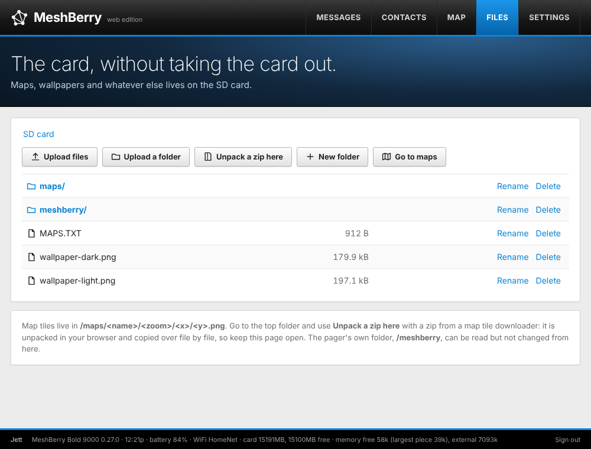

- Upload files or a whole folder, download by clicking a file, rename, delete, make folders.
- **Unpack a zip here** unpacks a zip in your browser and copies it over file by file. This is the easy way to put map tiles on the card for MeshBerry Bold 9000 ([Maps](MAPS.md)): go to the top folder and unpack the zip from a map tile downloader. Thousands of small files take a while; leave the page open until it finishes.
- A wallpaper for Bold 9000 can be copied over the same way ([how](BOLD-9000.md#wallpaper)).
- A file or folder name too long for the pager is shortened when you upload or rename it, keeping its ending (`.png` and so on).
- The pager's own folder, `/meshberry`, can be looked at but not changed, and the files in it that hold your WiFi passwords or an exported private key are not shown or served at all.
- Do not format or eject the card on the pager while the page is copying files.

## Settings

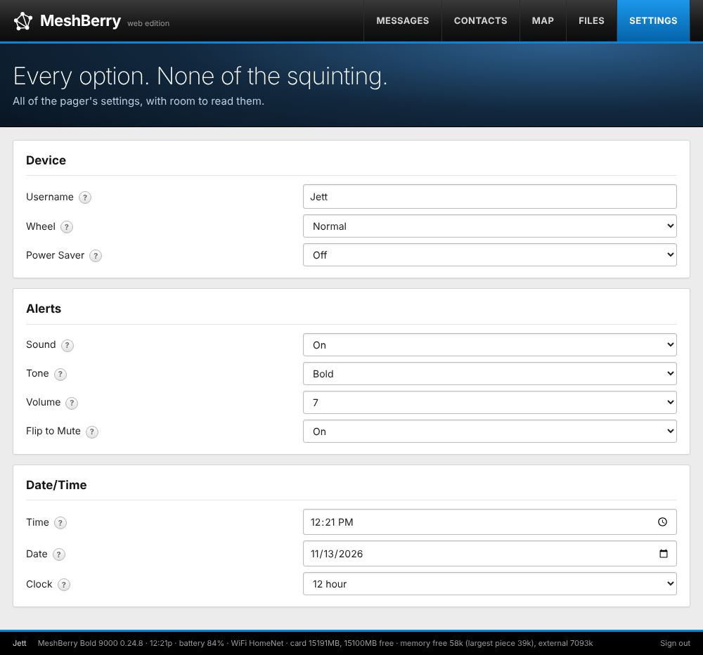

Everything in the pager's Options, group by group. A change takes effect on the pager at once. Each setting has a **?** with the same tip the pager shows.

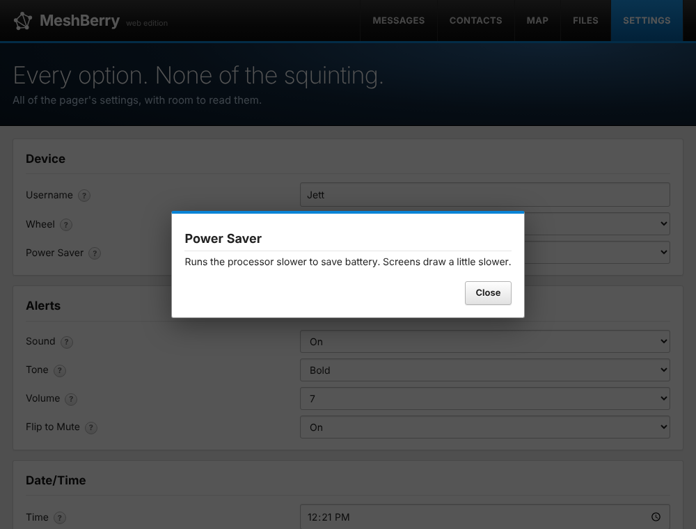

The clock, the date and the alarm time use your browser's own pickers. Your name can include emoji here, which the pager's keyboard cannot type; it is limited to 19 bytes, so a long one is shortened.

## On a phone

On a narrow screen the page drops the headline band and tightens up, so more fits.

| | |
|---|---|
| 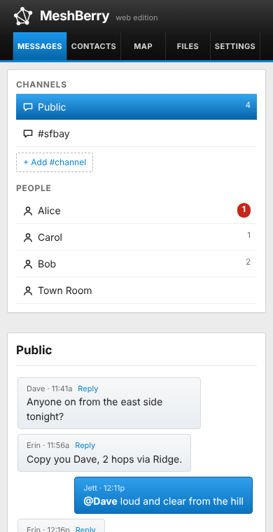 | 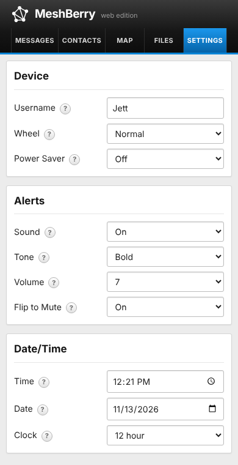 |

## Security: read this once

**The page is not encrypted.** It is plain `http`, so anyone else on the same WiFi network could watch what passes between your browser and the pager, including the sign-in. That is why the web interface starts by itself only on networks you have marked for it: ***mark your home network, not a shared or public one.***

- It is only reachable on the network the pager has joined, not from the internet.
- Nothing can be done without signing in with the number on the pager's screen.
- The private key file, the settings file (which holds WiFi passwords) and the pager's own folder are protected as described under [Files](#files).
- A signed-in browser is signed out after half an hour of doing nothing, and when the web interface stops.

---

See also: [Meshberry and Mesherola](MESHBERRY-MESHEROLA.md) · [MeshBerry Bold 9000](BOLD-9000.md) · [Feature comparison](FEATURES.md) · [Maps](MAPS.md)
